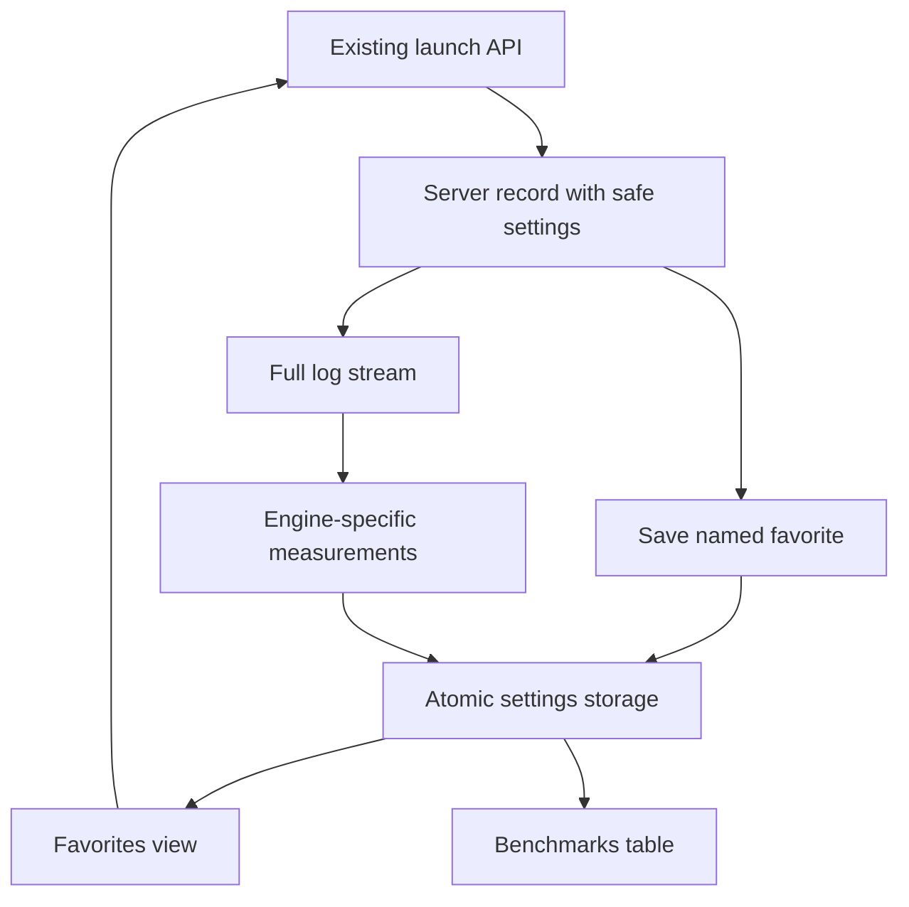

# Favorites and log benchmarks

## Goal Capsule

Users can preserve a working model configuration, relaunch it by name, and compare recorded inference performance.
Means: persist safe launch metadata and summarize engine logs (KTD1–KTD3).
Authority: issue #28 and the user request govern scope; commit and push the feature branch without opening a PR.
Stop if fulfilling the request would overwrite unrelated local changes.

---
## Product Contract

### Summary

Add Favorites beneath Launch and a Benchmarks navigation entry, with actions on each server card.

### Problem Frame

Working launch settings are currently lost as reusable configurations, and performance evidence remains buried in server logs.

### Requirements

- R1. Save Launch Settings to Favorites sits next to Test chat and asks for a nonempty name.
- R2. Favorites lists named models and settings; Launch recreates the server through existing validation and opens Servers.
- R3. Servers shows saved launch settings below the model and above log/chat/save/benchmark controls.
- R4. Benchmark reads logs and saves measured prefill/prompt and generation TPS with available token and timing counts.
- R5. Benchmarks lists models, settings, results, measurement basis and time in a table; absent metrics are unavailable, not zero.
- R6. Favorites and benchmark records survive launcher restarts; old servers remain readable without fabricated settings.
- R7. Retained and displayed launch metadata excludes credentials and internal derived fields.
- R8. Verify placement and appearance with actual browser screenshots, then commit and push without a PR.

### Scope Boundaries

No synthetic benchmark workload, new dependency, export, or unrelated engine control changes.

---
## Planning Contract

### Key Technical Decisions

- KTD1. Extend LocalServer records with optional sanitized launch configuration. Use catalog keys plus gguf_file as the allowlist, excluding credentials, and capture effective port/host. Refuse missing saved GGUF files instead of selecting a different file. Block saving configurations with launch-specific API credentials or credential-bearing extra arguments, explaining why, rather than silently replaying different authentication. Legacy records have unknown settings.
- KTD2. Reuse Settings atomic persistence and locking for favorite and benchmark lists. Favorites retain engine, model ID and configuration; launch routes through api_launch so discovery, hardware, binary paths and current credentials are revalidated.
- KTD3. Stream the full server log. llama.cpp averages use total tokens divided by total measured time; vLLM uses means of logged interval throughput and states that basis. Keep zero samples when reported, reject malformed values, and do not combine unlike engine measurements silently.

### Assumptions

Benchmark means analysis of the existing logs, as issue #28 specifies, rather than generating traffic.
Existing server records have no recoverable configuration; their logs can still be analyzed, but saving favorites requires a new launch.

### High-Level Technical Design

Directional data flow:

---
## Implementation Units

### U1. Persist reusable settings and favorites

Goal: satisfy R1, R2, R3, R6, R7 with the existing launch pathway.
Files: src/local_llm_launcher/config.py, src/local_llm_launcher/registry.py, src/local_llm_launcher/engines/base.py, src/local_llm_launcher/api.py, tests/test_favorites.py.
Approach: KTD1 and KTD2; append named snapshots under a lock and preserve settings on restart.
Patterns: existing Settings save/update and LocalServer record lifecycle.
Test scenarios:
- Launch captures effective settings, strips credentials, and survives ServerManager reload.
- Save a favorite, reload settings, and launch it with the original model/engine/config through existing validation.
- Blank name, missing server/favorite/model and legacy metadata produce clear errors.
Verification: focused API and persistence tests pass; existing lifecycle tests remain green.

### U2. Extract and persist benchmark measurements

Dependencies: U1.
Goal: satisfy R4, R5, R6, R7.
Files: src/local_llm_launcher/benchmarks.py, src/local_llm_launcher/api.py, tests/test_benchmarks.py.
Approach: KTD2 and KTD3; save snapshots of results with the launch settings and source server ID.
Patterns: API errors and Settings atomic updates.
Test scenarios:
- llama.cpp prompt/eval lines produce token/time weighted rates across requests.
- vLLM interval samples, including zero, produce separately labeled means.
- Malformed, empty or startup-only logs never produce invented measurements.
- A log larger than the UI tail is fully analyzed and its result survives source server removal and settings reload.
Verification: parser tests and API integration pass.

### U3. Integrate navigation, cards and benchmark table

Dependencies: U1, U2.
Goal: satisfy R1–R5 and R8.
Files: frontend/src/App.jsx, frontend/src/api.js, frontend/src/components.jsx, frontend/src/views/Servers.jsx, frontend/src/views/Favorites.jsx, frontend/src/views/Benchmarks.jsx, frontend/src/theme.css, src/local_llm_launcher/static/, docs/verification/issue-28.md.
Approach: reuse buttons, panels, row layout and data-table; wrap server actions and settings on narrow screens. Favorite launches refresh servers before navigation. Display unavailable metadata honestly.
Patterns: existing App navigation, toast notifications, view lifecycle and generated Vite build.
Test scenarios:
- Browser saves a named favorite, sees it beneath Launch, relaunches and sees settings on Servers.
- Benchmark action saves results and renders a table after navigation/reload.
- Empty states and error messages stay usable; long settings/actions fit desktop and narrow viewport in both themes.
Verification: lint/build, full Python suite, browser interaction assertions and inspected screenshots from the shipped bundle.

---
## Verification Contract

Use the existing project virtual-environment Python with PYTHONPATH pointing at this checkout: pytest tests/test_favorites.py tests/test_benchmarks.py, then pytest.
Run npm run lint and npm run build in frontend; verify the generated package bundle.
Use an isolated launcher home and a harmless local fixture engine for browser tests; preserve screenshot evidence with explicit fixture disclosure.
Inspect desktop and narrow screenshots and verify save, launch, log, chat, benchmark, navigation, persistence and errors.

---
## Definition of Done

All R1–R8 are implemented and verified; no abandoned implementation code or unrelated changes remain.
Record validation commands and browser screenshots, disclose hardware inference limits, and push only the feature branch.

### Sources

- https://github.com/jimdawdy-hub/Local-LLM-Launcher-GUI/issues/28
- src/local_llm_launcher/config.py and registry.py: atomic settings and server lifecycle.
- https://github.com/ggml-org/llama.cpp/blob/master/tools/server/server-context.cpp: prompt/eval timing fields.
- https://github.com/vllm-project/vllm/blob/main/vllm/v1/metrics/loggers.py: interval throughput log fields.
